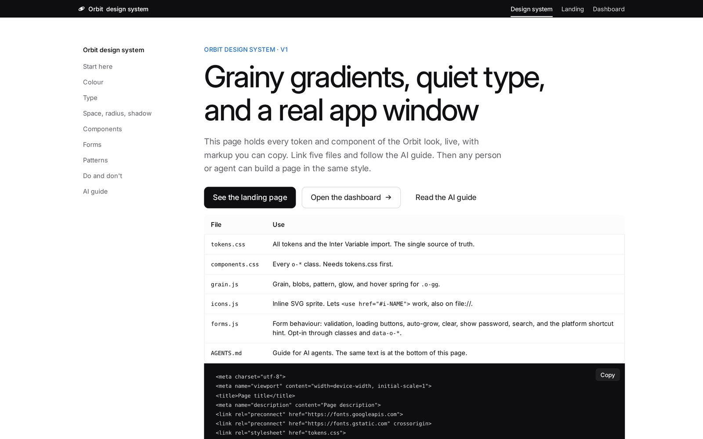
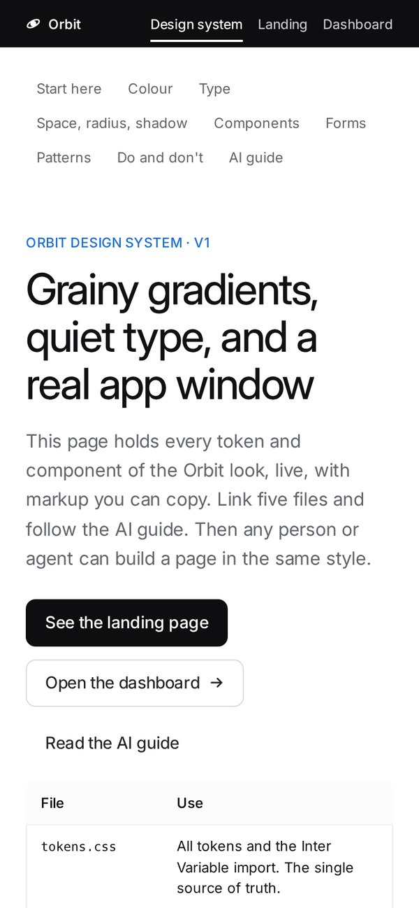
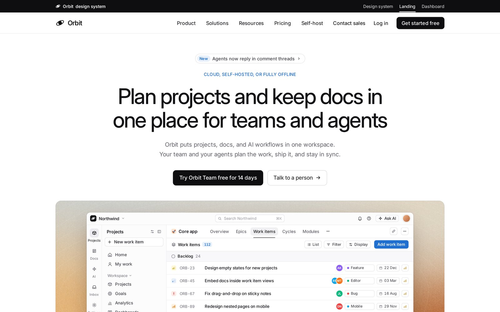
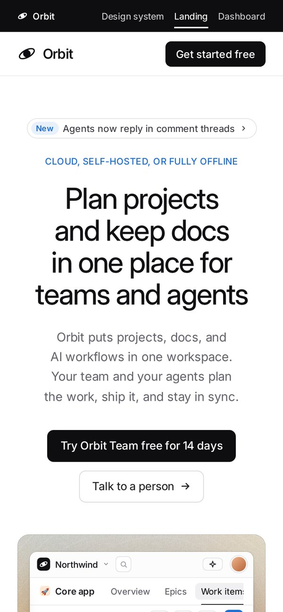
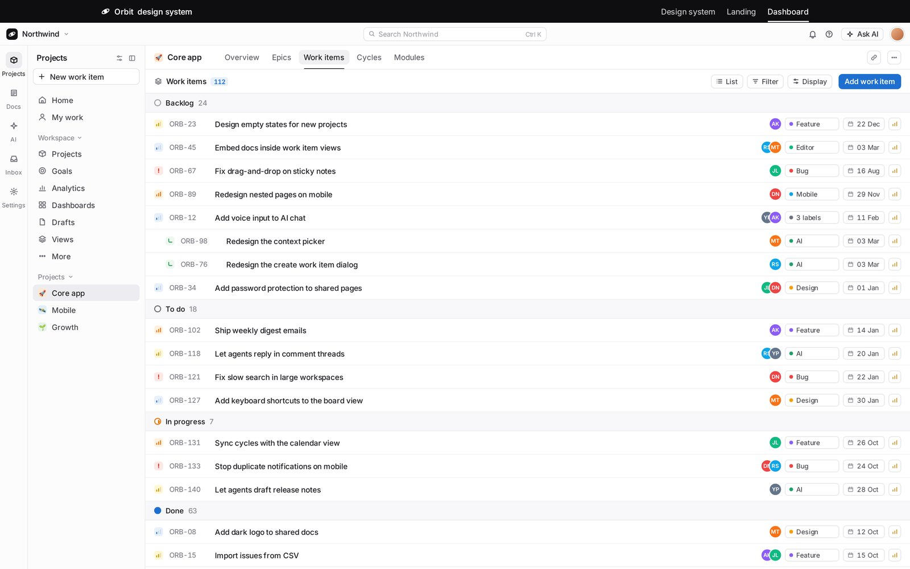
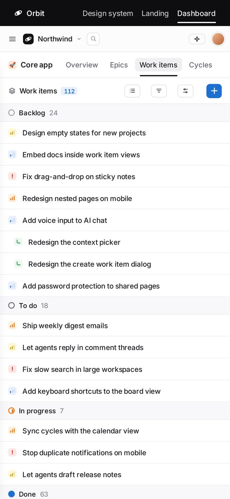
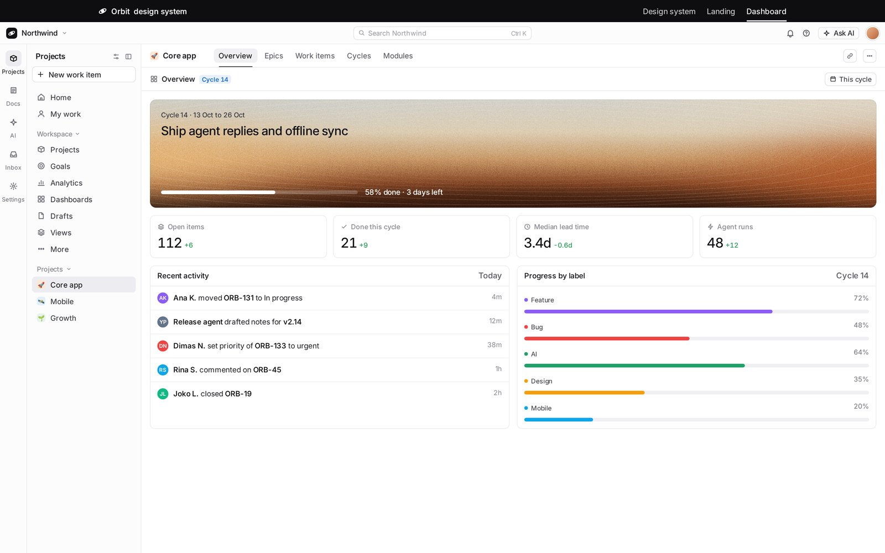
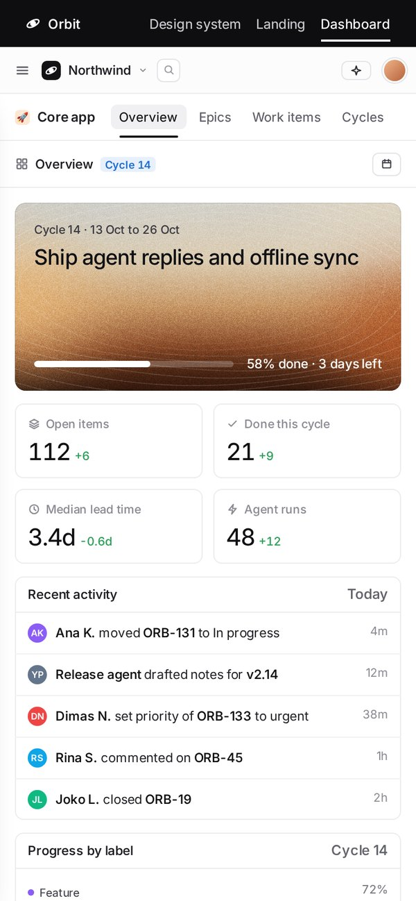

# Orbit design system

Orbit is a small HTML and CSS design system. It comes from the Orbit hero demo. The look is a grainy, warm gradient behind a real app window, with quiet Inter type.

It has no build step and no framework. Plain HTML, CSS and a little JavaScript.

Live: [https://julianromli.github.io/orbit-design-system/](https://julianromli.github.io/orbit-design-system/)

## Preview

### Design system ([live](https://julianromli.github.io/orbit-design-system/))

 

### Landing ([live](https://julianromli.github.io/orbit-design-system/landing.html))

 

### Dashboard: work items ([live](https://julianromli.github.io/orbit-design-system/dashboard.html))

 

### Dashboard: overview

 

## The three pages

| Page | What it shows |
| --- | --- |
| [`index.html`](index.html) | The design system doc. All tokens and components are live, and each one has markup you can copy. It also has the do and don't rules and the AI guide. |
| [`landing.html`](landing.html) | A full marketing landing page. The hero shows the dashboard mockup. |
| [`dashboard.html`](dashboard.html) | A full-screen preview of the app (the dashboard). |

A shared top bar links the three pages. All paths are relative, so the pages work from GitHub Pages (served from the repo root) and from a local `file://` open.

## Files

| File | Job |
| --- | --- |
| `tokens.css` | The single source of truth: colour, type, spacing, radius, shadow and motion tokens. It also loads Inter Variable. |
| `components.css` | Every `o-*` class. Needs `tokens.css` first. |
| `grain.js` | The grainy gradient: grain canvas, drifting blobs, contour or ray pattern, glow and the hover spring. |
| `icons.js` | The inline SVG icon sprite, so `<use href="#i-NAME">` works everywhere. |
| `forms.js` | Form behaviour: validation with inline errors, loading buttons, textarea auto-grow, clear and show-password buttons, search open/Esc, and the platform shortcut hint. Opt-in through classes and `data-o-*`. |
| `AGENTS.md` | The guide for AI agents. The same text is at the bottom of `index.html`. |
| `screenshots/` | Renders of each page at 1440 px and 390 px wide. |

## How to reuse it

1. Copy `tokens.css`, `components.css`, `grain.js`, `icons.js` and `forms.js` into your project.
2. Read `AGENTS.md`. It gives the `<head>` links, the token list, the class API, the composition rules and a page template.
3. Copy markup from `index.html`, `landing.html` or `dashboard.html`. Do not invent new values. Take every value from a token.

To change the look, change `tokens.css`. All pages follow.

When you ask an AI agent to build a page, give it `AGENTS.md` first.

## Notes

- Inter loads from Google Fonts through an `@import` in `tokens.css`. Offline, the pages fall back to the system font.
- Every control shows a keyboard focus outline, has a 44 px hit area on touch, and uses 16 px text in inputs on touch. `AGENTS.md` has the form and accessibility rules.
- The gradient stops moving when the user asks for reduced motion (`prefers-reduced-motion`).
- `.nojekyll` tells GitHub Pages to serve the files as they are.
